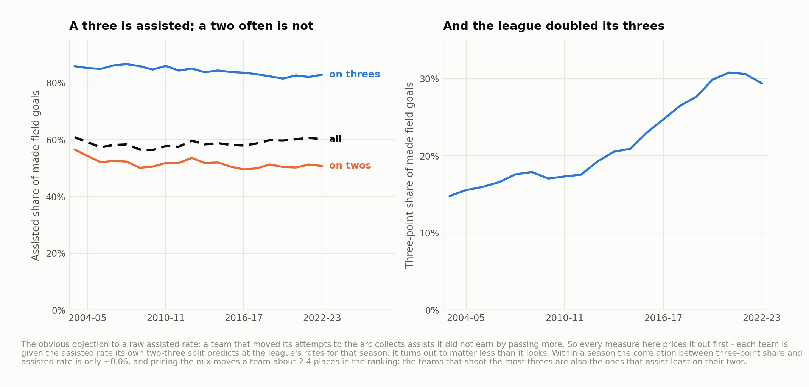
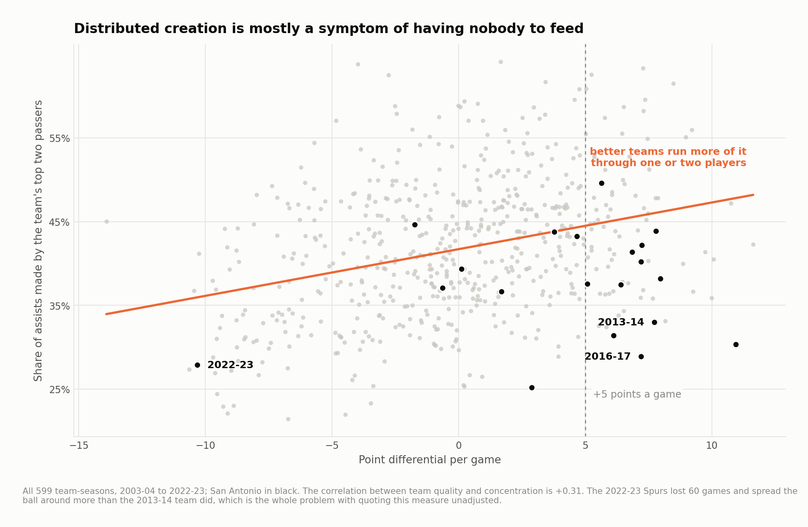
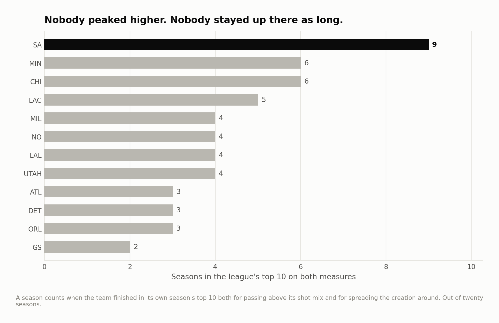

# The Beautiful Game, measured

In the 2014 Finals the Spurs passed the ball until somebody was open and then
passed it once more, and the phrase stuck. Ten years on it is the standard
example of a certain kind of offense — and, like most things everyone knows, it
has never had a number attached to it that survives a second look.

Twenty seasons of play-by-play, 23,832 games, 1,815,113 made field goals,
2003-04 to 2022-23.

**The volume claim is ordinary. The distribution claim is extraordinary — but
only once you account for the fact that bad teams look generous for free.**

---

## What the data can and cannot see

An assist is the only piece of passing in the public record. There is no touch
count, no pass count, no secondary assist, no time of possession. So the whole
project is an exercise in what can honestly be built from something that thin,
and there are exactly two things.

**How much of the scoring came off a pass.** The share of made field goals
carrying an assist.

**How many people did the creating.** The share of a team's assists made by its
top two passers. Low means the ball found a lot of hands.

Neither depends on an action-type label or a shot coordinate, which is the point:
both of those were re-recorded partway through this sample and are unusable
across it. The assist tag is not. The league's assisted rate sits between 56.3%
and 60.9% in every season, with no step at any boundary.

---

## The obvious objection, and how much it is worth

A three is assisted 81-87% of the time and a two about half the time. So a team
whose made baskets shift to the arc collects assists it did not earn by passing
more, and over this sample the league's share of made field goals worth three
doubled.



So the volume measure prices it out first: each team gets the assisted rate its
own two-three split predicts at the league's rates for that season, and only the
residual is read. (The concentration measure below needs no such correction — it
is a share of a team's own assists, so the shot mix cancels.)

Then it turns out to be worth almost nothing. Within a season the correlation
between three-point share and assisted rate is **+0.06**, and pricing the shot
mix moves a team an average of **2.4 places** in the ranking. The mechanical
effect is real — a point of three-point share is worth a tenth of a point of
assisted rate — but the teams that shoot the most threes are also the ones that
assist least on their twos, and the two very nearly cancel.

That is worth knowing before anyone builds a correction they do not need. I did
build it, and I have kept it, because it is the right thing to do and because
finding out it barely matters is itself the result. It is
also why the control that *does* matter is further down.

---

## The 2013-14 Spurs, on the volume claim

| | | League rank |
|---|---|---|
| Assisted share of made field goals | **62.1%** | 5th of 30 |
| What their shot mix predicts | 58.5% | |
| **Above their shot mix** | **+3.6 pp** | **6th of 30** |

Sixth. A good passing team, in a season with five better ones. If the beautiful
game means "assisted on more baskets than anybody", it did not happen.

---

## The claim that does hold

The Spurs argument was never really about volume. It was about the ball not
stopping anywhere — and that is a different statistic.

| | 2013-14 Spurs | League average |
|---|---|---|
| Tony Parker | 18.9% of the team's assists | |
| Manu Ginóbili | 14.1% | |
| **Top two combined** | **33.0%** | 42.2% |

Third-lowest in the league that season, and the third-most-frequent passer was
Boris Diaw at 10.8% — a power forward.


But this measure has a problem, and it is a bad one.



**Distributed creation is mostly a symptom of having nobody worth feeding.** Across
599 team-seasons, concentration correlates **+0.31** with point differential:
good teams have somebody good enough to run the offense through. The 2022-23
Spurs had the worst point differential in the league and spread the ball around
more than the 2013-14 team did.
Quoting this number unadjusted produces a leaderboard of bad basketball.

So condition on being good. Of the 86 team-seasons in twenty years with a point
differential of +5 or better:


| | Point differential | Top-two share |
|---|---|---|
| **2016-17 Spurs** | +7.2 | **28.9%** |
| **2015-16 Spurs** | +10.9 | **30.3%** |
| 2020-21 Clippers | +6.2 | 31.3% |
| **2014-15 Spurs** | +6.1 | **31.4%** |
| 2003-04 Pacers | +5.8 | 32.4% |
| 2021-22 Warriors | +5.5 | 32.6% |
| **2013-14 Spurs** | +7.7 | **33.0%** |

Four of the twenty most distributed good teams in twenty years are San Antonio,
and they are four consecutive seasons. Adjusting for team quality directly rather
than by cutoff, the 2013-14 team ranks **2nd of 599** — behind only the 2008-09
Rockets, who were doing something similar with a worse record.

---

## What was actually unusual

Not the peak. Forty-two team-seasons passed more above their shot mix than the
best any Spurs team managed — the 2009-10 Jazz by more than double — and seven
have been more distributed in a single season than San Antonio's most
distributed year.



**Nine seasons in the league's top ten on both measures at once.** Chicago and
Minnesota have six; nobody else has more than five. The thing that separates San
Antonio is not that they found this once. It is that they held it through a
roster turning over from Parker and Ginóbili to Kawhi Leonard to Pau Gasol and
Dejounte Murray, and the 2017-18 team — the last of the era, with Leonard hurt —
had the lowest top-two share in the league at **25.2%**, led by a 37-year-old
center.

Then Leonard left, and in one season the number went back to ordinary.

---

## Why this is worth doing carefully

The story here is not the answer, it is the order of the corrections. The
objection everybody raises — that assisted rate is really a shot-location
statistic — is correct in mechanism and worth 2.4 places in a ranking. The
objection nobody raises — that spreading the ball around is what teams do when
they have nobody to give it to — has a correlation of +0.31 with team quality,
moves a team a third of a standard deviation for every standard deviation of
team strength, and inverts the leaderboard.

Getting that the wrong way round is how a plausible measure becomes a bad one.

---

## Running it

```bash
pip install -r requirements.txt
python src/run_01_build.py       # 20 seasons of play-by-play -> two small tables
python src/run_02_beautiful.py   # price it, control it, figures 01-05
```

Or `make all`. Stage 1 reads 470 MB of play-by-play and takes about a minute;
the analysis itself is a couple of seconds.

```
src/
  config.py        paths, seasons, the sample floor
  passing.py       the two measures, and the shot-mix pricing
  labels.py        collision-resolving point labels
  style.py         one place that decides what every figure looks like
  run_0*.py        the pipeline, in order
output/            every number quoted above, as CSV
figures/           five figures, regenerated from scratch by the pipeline
docs/method.md     longer notes, including what this cannot see
```

## Data

Play-by-play from
[sportsdataverse/hoopR-data](https://github.com/sportsdataverse/hoopR-data), a
mirror of ESPN's public feeds. `data/README.md` has the fetch step and the
filters, including the one that keeps the All-Star Game out of the rankings.

## License

MIT. See `LICENSE`.
