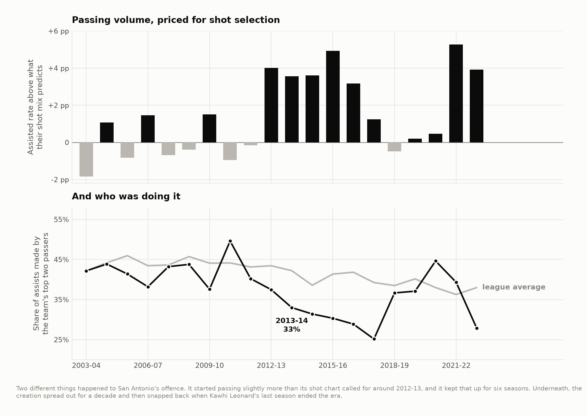
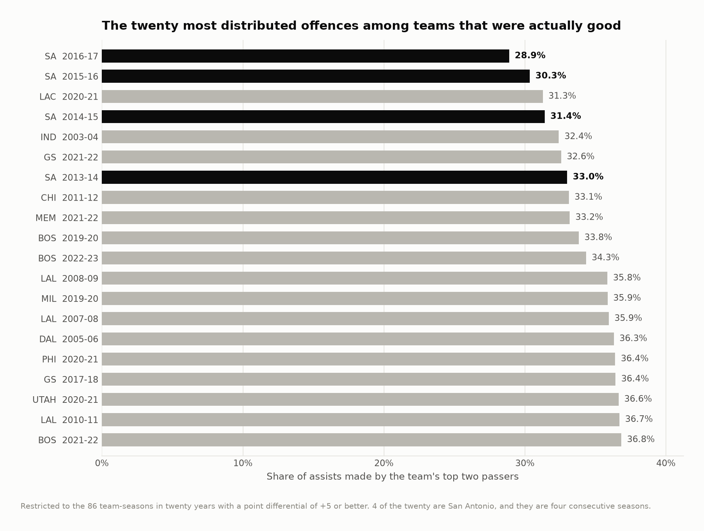

# The Spurs' assist distribution

How unusual was San Antonio's distribution of credited assists? This study uses public play-by-play from 2003–04 through 2022–23. It examines assisted makes and how concentrated a team's assists are among its leading passers.

## The 2013–14 reference season

Rates below are proportions, and `Above mix` is the difference from the season's shot-mix baseline. For example, 0.036 corresponds to 3.6 percentage points.

| Season | Games | Assisted rate | Expected | Above mix | Top2 | Rank above |
|---|---|---|---|---|---|---|
| 2013–14 | 82 | 0.621 | 0.585 | 0.036 | 0.330 | 6.000 |

Source: [spurs_path.csv](output/spurs_path.csv).



The Spurs' top-two share of assists was low relative to other successful teams. That is a statement about credited assists, not all passes or all creation. The [full team-season table](output/team_seasons.csv) retains the comparison population and quality-adjusted associations.

## Method

Expected assisted-make share weights league two-point and three-point assisted rates by each team's made-shot mix. Assist concentration is the top two players' share of the team's credited assists. Descriptive comparisons condition on scoring margin because concentration and team quality are associated in this sample.



Conditioning on team quality does not isolate a causal passing system. The data omit secondary assists, potential assists, failed passes and unconverted opportunities. The distribution also changes with minutes and player availability. Stable aggregate rates do not independently establish consistent scorekeeping across every arena and season.

## Front office implications

This can identify teams for a study of distributed creation. A useful film follow-up would distinguish advantage-creating passes from routine final passes before made baskets. Those possessions have not been coded here, so the project does not recommend a scheme or player acquisition from assist concentration alone.

## Reproduce

The historical analysis used Python 3.12 with the pinned dependencies below. From this repository:

```bash
python3.12 -m venv .venv
source .venv/bin/activate
python -m pip install -r requirements.txt
make fetch-data PY=python
make all PY=python
make report site PY=python
```

`make all` verifies source hashes before running the analyses in order. A missing or changed input stops the build. Data downloads need network access; article rendering uses the included result tables. See [the source manifest](data/source_manifest.json), [method notes](docs/method.md) and [current validation record](VALIDATION_CURRENT.md) for the distinction between a source rebuild and checks of delivered outputs.

Season keys in CSV files use the **ending year**: `2025` means 2024–25. Display tables use full season labels. The MIT license covers code; third-party data retain their providers' rights and terms.

[Portfolio](https://github.com/jmsmarrelli/basketball-analytics) · [AI assistance and provenance](PROVENANCE.md)
